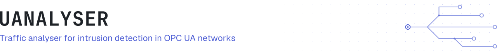

<!-- brand:header:start -->
<picture>
  <source media="(prefers-color-scheme: dark)" srcset="assets/brand/header-da37f6b9-dark.svg">
  
</picture>
<!-- brand:header:end -->

<!-- badges:start -->
[](https://www.repostatus.org/#inactive)
[](https://github.com/JonathanTSilva/uanalyser/actions/workflows/ci.yml)
[](https://codecov.io/gh/JonathanTSilva/uanalyser)
[](https://sonarcloud.io/summary/new_code?id=JonathanTSilva_uanalyser)
[](https://scorecard.dev/viewer/?uri=github.com/JonathanTSilva/uanalyser)
[](LICENSE)
[](https://codespaces.new/JonathanTSilva/uanalyser)
<!-- badges:end -->

**See the attack start in the traffic.** uanalyser reads a PCAPNG capture of OPC UA traffic, finds the packet where an attack begins and plots what the network did before and after it.

<p align="center">
  
  
</p>

*Throughput (left) and OPC UA packets per second (right) over one minute of a `hping3` DoS flood. The dashed red line marks the detected start. Plot labels are in Portuguese, the language of the original research.*

## What it is

A research tool built for an MSc project on intrusion detection in OPC UA networks, the protocol that industrial plants use to move machine data. Given a capture of the traffic between a server and a client, it:

- **Finds the attack.** It flags the packet where a denial-of-service attack starts.
- **Measures the link.** It computes throughput, OPC UA packets per second and round-trip times for the client and for the attacker.
- **Adds machine load.** When CPU and memory data were recorded during the capture, it plots that next to the traffic.
- **Draws every result as a PNG**, one file per metric.

The test set covers five DoS attacks, two man-in-the-middle attacks (ARP spoofing and port mirroring) and a normal-traffic baseline, each captured in the three OPC UA security modes: None, Sign and Sign & Encrypt. The project is finished and no longer maintained, and it stays public as a record of the work.

## Quick start

```sh
git clone https://github.com/JonathanTSilva/uanalyser.git
cd uanalyser
uv sync
uv run pytest
```

Or open it in a dev container or GitHub Codespaces.

## Usage

The code is a set of scripts run from the checkout, not an installable package. Analyse one capture with `main`, which writes the plots to `uanalyser/output/`:

```sh
PYTHONPATH=uanalyser uv run python -c "from main import main; main('tests/assets/0-dos_attack_example.pcapng')"
```

Capture file names follow `<type>-<attack name>.pcapng`, where the type is the OPC UA security mode: `0` for None, `1` for Sign and `2` for Sign & Encrypt. Pass `show_plots=True` to open the plots instead of only saving them. The full capture set and the performance CSV files used in the research are not in this repository: `uanalyser/paths.py` expects them under `Data/`.

## Docs

The [capture guide](docs/captures.md) lists every test capture with its hosts and the packet where the attack starts. The API reference is a MkDocs site generated from the docstrings, with the entry page in [`docs/index.md`](docs/index.md). Build it locally with `uv sync --group docs` and `uv run mkdocs serve`. The conventions this repository follows are in the [handbook](https://github.com/JonathanTSilva/.github/blob/main/handbook/README.md).

## Contributing

See the [contributing guide](https://github.com/JonathanTSilva/.github/blob/main/CONTRIBUTING.md). Branches are named `<type>/<issue>-<slug>`, commits and PR titles follow Conventional Commits, and PRs are squash-merged. The project is inactive, so changes are unlikely to be reviewed quickly.

## License

MIT. See [LICENSE](LICENSE).

Author: [Jonathan T. da Silva](https://github.com/JonathanTSilva).

<!-- brand:footer:start -->
<p align="right"><a href="https://www.jontobias.com"><picture>
  <source media="(prefers-color-scheme: dark)" srcset="https://raw.githubusercontent.com/JonathanTSilva/.github/main/assets/brand/jontobias-dark.svg">
  
</picture></a></p>
<!-- brand:footer:end -->
